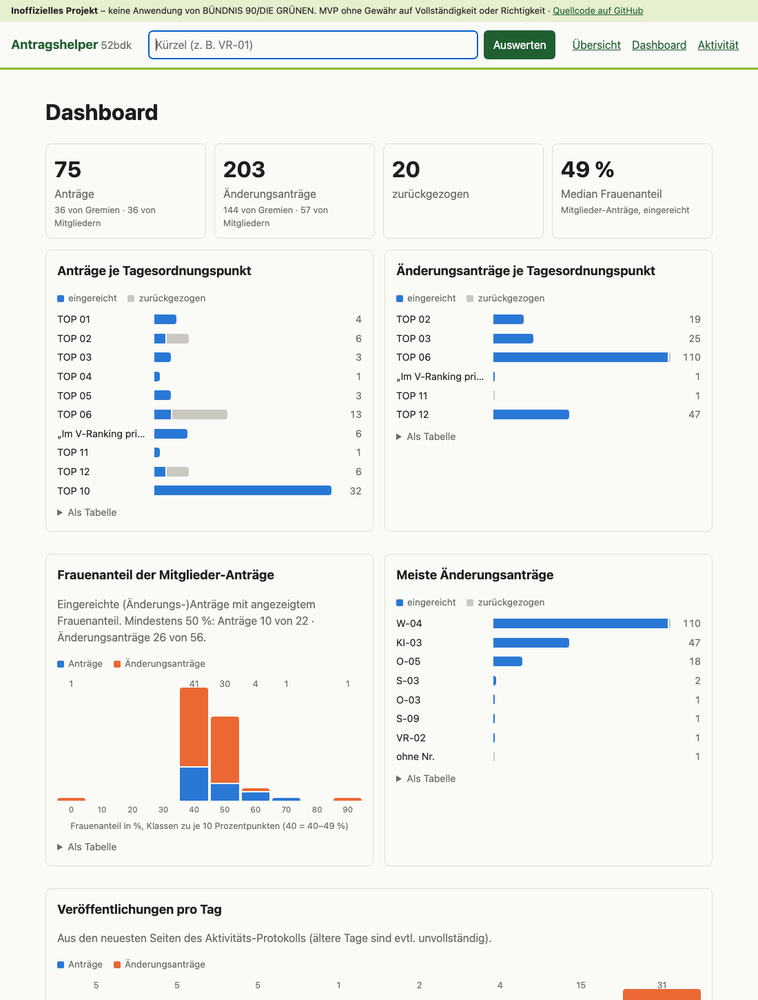
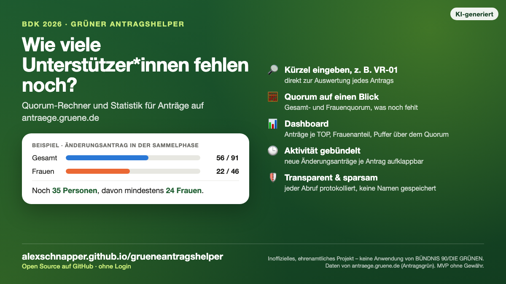

# 🌻 Grüne Antragshelper

**Quorum-Rechnung und Statistik für Anträge auf [antraege.gruene.de](https://antraege.gruene.de/) – ohne Login ins Grüne Netz.**

[](https://github.com/alexschnapper/grueneantragshelper/actions/workflows/pages.yml)


👉 **Online ansehen:** <https://alexschnapper.github.io/grueneantragshelper/>

> [!IMPORTANT]
> **Inoffizielles Projekt.** Der Grüne Antragshelper ist **keine Anwendung von BÜNDNIS 90/DIE GRÜNEN**
> und steht in keiner Verbindung zur Partei oder zur Bundesgeschäftsstelle.
> Er ist ein **MVP für die 52. Bundesdelegiertenkonferenz (BDK)** und wird **ohne Garantie oder Gewähr
> auf Vollständigkeit oder Richtigkeit** bereitgestellt. Verbindlich sind ausschließlich die Angaben auf
> [antraege.gruene.de](https://antraege.gruene.de/).



---

## ✨ Was kann der Antragshelper?

| | |
|---|---|
| 🔎 **Suche** | Antragskürzel (z. B. `VR-01`, `W-04-070`) oder Link eingeben → direkt zur Auswertung |
| 🧮 **Quorum-Rechnung** | Gesamt- und Frauenquorum, aktueller Stand, wie viele Personen und Frauen noch fehlen, wie viele Plätze frei sind |
| 📋 **Listen** | Anträge und Änderungsanträge je Tagesordnungspunkt, filterbar, Änderungsanträge nach Hauptantrag gruppiert, zurückgezogene getrennt |
| 📊 **Dashboard** | Anträge je TOP, Gremien vs. Mitglieder, Verteilung des Frauenanteils, meiste Änderungsanträge, Veröffentlichungen pro Tag, „Puffer über dem Quorum“ |
| 🕒 **Aktivität** | Aktivitäts-Protokoll, nach Antrag gruppiert und aufklappbar |
| 👀 **Beobachten** | Anträge in der Sammelphase per Direktlink beobachten, inklusive Verlauf |
| 🔍 **Transparenz** | Jeder Abruf bei antraege.gruene.de mit Zeitpunkt, Zweck und Größe; Laufprotokoll mit Anlass; im Footer letzter Abruf und nächste geplante Prüfung |

**Datenschutz:** Es werden **keine Namen** von Antragsteller*innen oder Unterstützer*innen und **kein
Antragstext** ausgelesen oder gespeichert – nur Kürzel, Titel, Links und Zahlen.

### Warum fehlen Anträge in der Sammelphase?

Antragsgrün blendet (Änderungs-)Anträge mit dem Status „Antragsteller*innen sammeln“ für alle ohne
Berechtigung aus: Sie stehen nicht in der Tagesordnung, nicht unter dem Hauptantrag, nicht in Suche,
Feeds oder Aktivitäts-Protokoll. Der Antragshelper kann sie daher **nicht selbst finden** – sie kommen
nur über ihren Direktlink in die Beobachtungsliste. Eine leere Liste heißt also nicht, dass kein Antrag
Unterstützung braucht. Hintergründe stehen in [KONZEPT.md](KONZEPT.md).

---

## 🚀 Lokal ausführen

Voraussetzung: Python 3.9 oder neuer.

```sh
git clone https://github.com/alexschnapper/grueneantragshelper.git
cd grueneantragshelper
python3 -m venv .venv
.venv/bin/pip install -e '.[dev]'
```

| Befehl | Was passiert |
|---|---|
| `.venv/bin/python -m antragshelper server` | Web-App auf <http://127.0.0.1:8000> (mit Beobachten und Verlauf) |
| `.venv/bin/python -m antragshelper zeige VR-01` | Auswertung direkt im Terminal (Kürzel oder Link) |
| `.venv/bin/python -m antragshelper build --out _site` | Statische Seite erzeugen (wie auf GitHub Pages) |
| `.venv/bin/pytest` | Tests ausführen |

Optionen für `build`:

- `--details` – ruft zusätzlich die Einzelseiten der veröffentlichten Mitglieder-Anträge ab (gedrosselt,
  1 Seite pro Sekunde, ca. 1,5 Minuten) für die Quorum-Auswertung im Dashboard.
- `--beobachten beobachtet.txt` – Direktlinks zu Anträgen in der Sammelphase (eine URL pro Zeile).

Konfiguration über Umgebungsvariablen:

| Variable | Standard |
|---|---|
| `ANTRAGSHELPER_BASE_URL` | `https://antraege.gruene.de` |
| `ANTRAGSHELPER_CONSULTATION` | `52bdk` |
| `ANTRAGSHELPER_DB` | `data/antragshelper.sqlite3` |

## 🌐 GitHub Pages

Der Workflow [`.github/workflows/pages.yml`](.github/workflows/pages.yml) hält die Seite aktuell und
geht dabei sparsam mit antraege.gruene.de um:

| Wann | Was | Abrufe |
|---|---|---|
| stündlich | **Prüfung** (`antragshelper check`): Seite 1 des Aktivitäts-Protokolls und beobachtete Links, verglichen mit `static/stand.json` der veröffentlichten Seite | 1 + je 1 pro Link in `beobachtet.txt` |
| nur bei Änderung | **Neubau**: Startseite, Aktivitäts-Protokoll, Quorum-Zahlen **nur für neue** Mitglieder-Anträge (ältere gelten 7 Tage) | ca. 6 + neue Anträge |
| nachts, bei Push, auf Knopfdruck | Sicherheits-Build (z. B. für zurückgezogene Anträge, die nicht im Protokoll stehen) | wie Neubau |

Warum nicht die Feeds? `feedall` & Co. sind nach Anlegedatum sortiert und enthalten nur 20 Einträge –
spät veröffentlichte Änderungsanträge tauchen dort nicht auf. Das Aktivitäts-Protokoll ist kleiner
(ca. 16 statt 55 KB) und nach Ereignis sortiert.

Einmalig einrichten: **Settings → Pages → Build and deployment → Source: „GitHub Actions“**.

Anträge in der Sammelphase können in [`beobachtet.txt`](beobachtet.txt) eingetragen werden. Die Datei ist
öffentlich – bitte nur Links eintragen, die die Antragsteller*innen selbst öffentlich teilen.

Die statische Version kann nichts speichern: Beobachten per Knopf, Verlauf und Auswertung beliebiger
Links gibt es nur in der lokal ausgeführten App.

## 🤝 Rücksicht auf antraege.gruene.de

Der Antragshelper ruft nur öffentlich verlinkte Seiten ab, speichert sie zwischen und drosselt
Einzelabrufe (1 Seite pro Sekunde). IDs werden **nicht** durchprobiert. Die GitHub-Pages-Version
prüft stündlich mit einem einzigen kleinen Abruf und baut nur bei Änderungen neu. Welche Seiten
wann und warum abgerufen wurden, steht auf der Seite
[Transparenz](https://alexschnapper.github.io/grueneantragshelper/transparenz.html).

## 📣 Teilen

Fertige Sharepics (KI-generiert, als inoffiziell gekennzeichnet) liegen in [`docs/sharepic/`](docs/sharepic/):
[Hochformat 1080 × 1350](docs/sharepic/sharepic-1080x1350.png) für Instagram/Facebook und
[Querformat 1200 × 675](docs/sharepic/sharepic-1200x675.png) für Mastodon, Bluesky, LinkedIn und X.



## 💚 Danke

Ein großes Dankeschön an die Entwickler*innen von **[Antragsgrün](https://github.com/CatoTH/antragsgruen)**,
der Open-Source-Software hinter antraege.gruene.de. Ohne ihre Arbeit – und den offenen Quellcode, aus dem
sich Seitenaufbau und Texte ablesen ließen – gäbe es dieses Projekt nicht.

## 📄 Lizenz

[GPL-3.0](LICENSE). Beiträge, Hinweise und Issues sind willkommen.
