# Lizenz: Warum AGPL-3.0?

Der Antragshelper steht unter der **GNU Affero General Public License v3.0 oder später** (AGPL-3.0-or-later). Bis dahin galt die GPL-3.0.

## Der Unterschied in einem Satz

Die AGPL ist die GPL plus eine Klausel (§13): Wer eine **geänderte** Version als Webdienst betreibt, muss den Nutzer*innen den Quellcode dieser Version anbieten. Bei der GPL greift die Pflicht erst bei der Weitergabe von Kopien, ein gehosteter Fork könnte also geschlossen bleiben.

## Warum für dieses Projekt?

- Antragsgrün, die Software hinter antraege.gruene.de, ist selbst AGPL-3.0. Die Lizenz passt zum Ökosystem.
- Der Antragshelper hat einen Server-Modus (`python -m antragshelper server`) und eine gehostete Seite. Auch gehostete Forks sollen offen bleiben.
- Für Nutzer*innen und für die statische GitHub-Pages-Seite ändert sich nichts.

## Verhältnis zu Antragsgrün

Der Antragshelper übernimmt **keinen Antragsgrün-Code**, sondern liest nur öffentliche HTML-Seiten aus. Selektoren und Textformate sind Fakten über das Markup, keine Code-Kopie. Die AGPL von Antragsgrün erzwingt deshalb keine bestimmte Lizenz hier. Die Wahl der AGPL ist eine freiwillige, passende Entscheidung. Würde je Code oder Template aus Antragsgrün kopiert, bliebe dieser Teil AGPL.

## Was bedeutet das praktisch?

| Wer | Pflichten |
| --- | --- |
| Nutzt das Tool oder die gehostete Seite | keine |
| Hostet es unverändert | Lizenztext beilegen (kein Code-Angebot für Änderungen nötig, da keine vorhanden) |
| Ändert es und stellt es als Webdienst bereit | Quellcode der geänderten Version den Nutzer*innen anbieten, unter AGPL-3.0 |
| Gibt Kopien weiter (wie bei der GPL) | Quellcode mitgeben, unter AGPL-3.0 |

Der Footer jeder Seite verlinkt auf den Quellcode ("Quellcode auf GitHub") und erfüllt damit §13 für die gehostete Seite. Den Link bitte nicht entfernen.

## Hintergrund zum Wechsel

- Alle bisherigen Commits stammen von derselben Person, es war keine Zustimmung Dritter nötig. Bei künftigen Beiträgen gilt: Beiträge erfolgen unter der Projektlizenz (AGPL-3.0).
- Abhängigkeiten (httpx, FastAPI, Jinja2, BeautifulSoup, segno u. a.) sind MIT/BSD-lizenziert und mit der AGPL kompatibel.
- Bereits veröffentlichte Versionen bleiben unter der GPL-3.0 nutzbar, in der sie veröffentlicht wurden.

Das ist keine Rechtsberatung.
